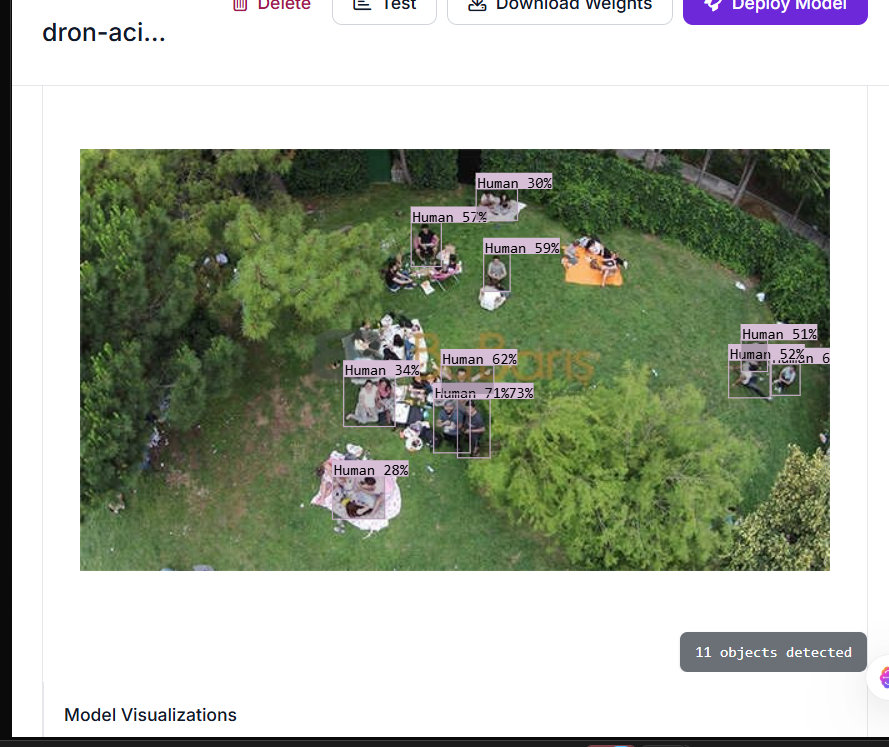

# 🚁 Drone Görüntülerinden Nesne Tespiti (Object Detection)

Bu proje, Roboflow platformu kullanılarak drone (İHA) görüntülerinden insan/nesne tespiti yapmak amacıyla gerçekleştirilmiştir.

---

## 📌 Proje Özeti
* **Amaç:** Havadan çekilen drone görüntülerinde nesnelerin otomatik tespiti ve sınıflandırılması.
* **Platform:** Roboflow (Dataset Management, Auto-Labeling, Cloud Training)
* **Veri Seti:** 205 Adet Etiketli Görsel (Train, Validation, Test)
* **Proje Tipi:** Object Detection (Bounding Box)

---

## 🔍 Temel Kavramlar
* **Görüntü İşleme (Image Processing):** Dijital görüntülerin kalitesini artırma, filtreleme ve yapay zekâ modeline hazır hale getirme işlemidir.
* **Bilgisayarlı Görü (Computer Vision):** Bilgisayarların dijital görsellerden ve videolardan yüksek düzeyde anlam çıkarmasını sağlayan yapay zekâ disiplinidir.
* **Nesne Tespiti (Object Detection):** Görüntüdeki nesnelerin ne olduğunu (Sınıflandırma) ve nerede olduğunu (Bounding Box ile Konumlandırma) bulma işlemidir.

---

## ⚙️ Uygulama Adımları

### 1. Veri Seti ve Etiketleme 
Roboflow Universe üzerinden temin edilen drone görselleri projemize aktarılmış ve sınıfları (`Human`) belirlenmiştir. Görseller üzerindeki sınırlayıcı kutucuklar (Bounding Box) kontrol edilmiş ve hatalı etiketler düzeltilmiştir.

 
### 2. Veri Bölme ve Ön İşleme 
Veri seti model eğitimi için otomatik olarak bölünmüştür:
* **Train Set (%70):** 135 Görsel
* **Validation Set (%20):** 47 Görsel
* **Test Set (%10):** 23 Görsel
* **Ön İşleme & Augmentation:** Auto-Orient, Resize (640x640) ve Veri Artırma yöntemleri uygulanarak sürüm 1 (v1) oluşturulmuştur.

---

## 📊 Model Eğitim Sonuçları ve Metrikler 

Yapay zekâ modeli Roboflow Cloud altyapısında eğitilmiş ve aşağıdaki başarı oranları elde edilmiştir:

 

| Metrik | Başarı Oranı | Açıklama |
| :--- | :--- | :--- |
| **Precision (Hassasiyet)** | **%88.9** | Modelin nesne dediği tahminlerin doğruluk oranı. Yanlış alarm oranı düşüktür. |
| **Recall (Duyarlılık)** | **%80.0** | Görüntüdeki gerçek nesnelerin yakalanma oranı. |
| **mAP@50** | **%76.4** | Nesne tespiti genel başarı puanı. |
| **F1 Score** | **%84.2** | Precision ve Recall değerlerinin dengeli ortalaması. |

---

## 🧪 Test Görselleri ve Tahmin Sonuçları (Görev 12)

Eğitilen model, eğitimde kullanılmayan test görselleri üzerinde denenmiş ve drone açısından bakıldığında insan gruplarını yüksek doğrulukla tespit ettiği gözlemlenmiştir.

 
---

## 🏁 Sonuç
Proje kapsamında Roboflow platformu kullanılarak uçtan uca veri seti hazırlama, etiketleme kontrolü, veri artırma, model eğitimi ve test aşamaları başarıyla tamamlanmıştır. Model, drone görüntülerinde %88.9 precision ile güvenilir tespitler gerçekleştirebilmektedir.
